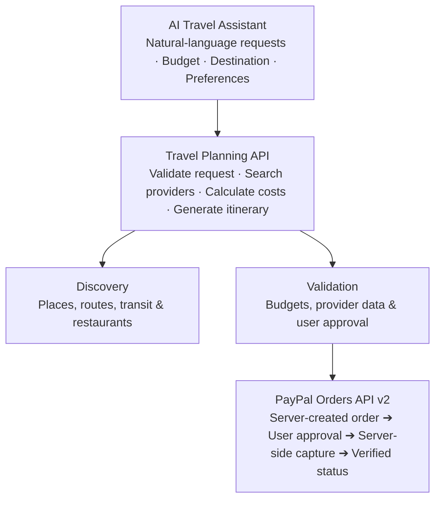

# 🧭 PayNGo – AI Travel Companion & Instant PayPal Checkout
**PayPal AI Hackathon 2026 Submission**

> **Tagline:** Your AI travel agent that finds the best local experiences *and* pays for them seamlessly using PayPal.

---

## 🚀 Overview

**PayNGo** is an intelligent full-stack travel companion built for newcomers, solo travelers, and tourists exploring new cities. It solves the fragmented nightmare of finding authentic spots, comparing ride app prices across multiple services (Rapido, Uber, Ola, Metro, Walking), and navigating risky payment flows.

With **PayNGo**, travelers can ask in natural language or tap live radar recommendations to compare options and complete payments via **PayPal Orders API v2** in a single fluid experience.

---

## ✨ Key Features

1. **🎯 Smart Newcomer Discovery Radar**
   - Geolocation-aware local radar ranking restaurants, hotels, and attractions by ratings, newcomer score (0–100%), distance, and price.

2. **🤖 Agentic AI Travel Assistant**
   - Natural language intent processing ("Find pure-veg dinner under ₹500 and pay").
   - Tool execution (`search_places`, `compare_rides`, `create_paypal_order`, `build_itinerary`).
   - One-click agentic payment approvals inside the chat drawer.

3. **🚖 Real-Time Multi-Modal Ride Price Estimator**
   - Live price, duration, ETA, and carbon footprint comparison across:
     - **Rapido Bike** (Fastest)
     - **Ola / Local Auto** (Best Value)
     - **Uber Go Cab**
     - **Namma / City Metro** (Cheapest & Eco-Friendly)
     - **Walking**

4. **💳 Deep PayPal Orders API v2 Integration**
   - **Create Order API** (`POST /v2/checkout/orders`): Generates 256-bit encrypted checkout authorizations.
   - **Capture Order API** (`POST /v2/checkout/orders/{id}/capture`): Locks in transactions and issues digital receipts.
   - **React PayPal JS SDK**: Standard PayPal smart buttons with Instant Sandbox fallback mode for hackathon evaluation.

5. **🗺️ Inter-City Multi-Modal Itinerary Planner**
   - Affordable multi-modal plans (e.g. Bengaluru ➔ Mysuru / Delhi ➔ Jaipur) with itemized breakdown (Train + Cab + Bus) and single-click PayPal booking.

---

## 🛠️ Complete Tech Stack

- **Framework**: Next.js 14 (App Router) + TypeScript
- **Styling**: Tailwind CSS + Glassmorphic UI design system
- **Icons**: Lucide React
- **Payments**: PayPal Orders API v2 (`@paypal/react-paypal-js`)
- **Database & Auth**: Supabase PostgreSQL (`@supabase/supabase-js`) with offline fallback
- **AI Agent**: Google Gemini 2.0/1.5 Flash & Agentic NLU with Tool-calling API routes (offline fallback included)
- **Maps**: Interactive Geolocation Radar & Leaflet Engine

---

## ⚡ Quick Start & Installation

### 1. Clone & Install Dependencies
```bash
git clone https://github.com/your-repo/payngo.git
cd payngo
npm install
```

### 2. Configure Environment Variables
Copy `.env.example` to `.env.local`:
```bash
cp .env.example .env.local
```

Add your Credentials:
```env
# PayPal Sandbox Credentials (https://developer.paypal.com)
NEXT_PUBLIC_PAYPAL_CLIENT_ID=your_sandbox_client_id
PAYPAL_CLIENT_SECRET=your_sandbox_secret
PAYPAL_ENV=sandbox

# Supabase Database & Auth (https://supabase.com - Schema located in supabase/schema.sql)
NEXT_PUBLIC_SUPABASE_URL=https://your-project-id.supabase.co
NEXT_PUBLIC_SUPABASE_ANON_KEY=your_supabase_anon_public_key
```

### 3. Run Development Server
```bash
npm run dev
```
Open [http://localhost:3000](http://localhost:3000) in your browser.

---

## 🏗️ System Architecture



### 1. Architectural Layers & Flow

* **🤖 AI Travel Assistant**: Handles natural-language user requests, parsing budget constraints, target destinations, and personal preferences.
* **⚡ Travel Planning API**: Core orchestrator that validates incoming requests, searches provider endpoints, calculates multi-modal costs, and generates dynamic itineraries.
* **🔍 Discovery Layer**: Queries verified datasets for local places, point-to-point transit routes, ride providers, and dining options.
* **🛡️ Validation Layer**: Enforces strict budget caps, verifies provider pricing data, and collects explicit user confirmation.
* **💳 PayPal Orders API v2**: Performs secure 3-step payment processing:
  $$\text{Server-created order} \longrightarrow \text{User approval} \longrightarrow \text{Server-side capture} \longrightarrow \text{Verified status}$$

> **🔒 Security Principle**: The AI can propose a purchase, but it **cannot** silently authorize payment. Prices are recalculated and validated by the backend, and the server verifies the PayPal capture response before marking an order as paid.

---

## 📂 Project Structure

```
PAYPAL/
├── src/
│   ├── app/
│   │   ├── api/
│   │   │   ├── paypal/create-order/route.ts  # PayPal Orders API v2 Create
│   │   │   ├── paypal/capture-order/route.ts # PayPal Orders API v2 Capture
│   │   │   ├── ai/chat/route.ts              # Agentic Tool Calling API
│   │   │   ├── places/route.ts               # Smart Local Search
│   │   │   └── rides/route.ts                # Multi-modal Fare Estimator
│   │   ├── globals.css                       # Dark Glassmorphism Styles
│   │   ├── layout.tsx                        # Root Metadata & Fonts
│   │   └── page.tsx                          # Core Application Dashboard
│   ├── components/
│   │   ├── Navbar.tsx                        # Floating Pill Header & City/Currency Switcher
│   │   ├── HeroHeader.tsx                    # Search & Quick AI Prompts
│   │   ├── SmartMap.tsx                      # Geolocation Radar Map
│   │   ├── PlaceCard.tsx                     # Experience Card & PayPal Trigger
│   │   ├── RideCalculatorModal.tsx           # Multi-Ride Price Comparison
│   │   ├── PayPalCheckoutDrawer.tsx          # PayPal Checkout & SDK Buttons
│   │   ├── BookingSuccessModal.tsx           # Confirmation Receipt & QR
│   │   ├── AIChatSidebar.tsx                 # Agentic Chat Assistant
│   │   ├── InterCityPlanner.tsx              # Multi-Modal Trip Planner
│   │   └── TechStackFooter.tsx               # Hackathon Showcase Footer
│   ├── lib/
│   │   ├── paypal.ts                         # Server-Side PayPal Orders API SDK
│   │   ├── fareEngine.ts                     # Fare Calculation Algorithm
│   │   └── mockData.ts                       # Pan-India Cities & Discovery Dataset
│   └── types/
│       └── index.ts                          # TypeScript Definitions
├── .env.example
├── package.json
└── README.md
```

---

## 🧪 Testing PayPal Sandbox Orders API

1. Click on **"Pay with PayPal"** on any place card or ride calculation modal.
2. The PayPal Checkout Drawer opens, invoking `POST /api/paypal/create-order`.
3. Test using standard PayPal Sandbox accounts or click **"Instant Sandbox One-Click Pay"** for instant verification.
4. On approval, `POST /api/paypal/capture-order` captures funds and displays the verified **PayNGo Confirmation Receipt**.

---

## 🏆 Hackathon Value Proposition

From *"I don't know where to go"* ➔ *"Here is the best spot + the cheapest way to get there + payment completed via PayPal"* in a single intelligent flow.
